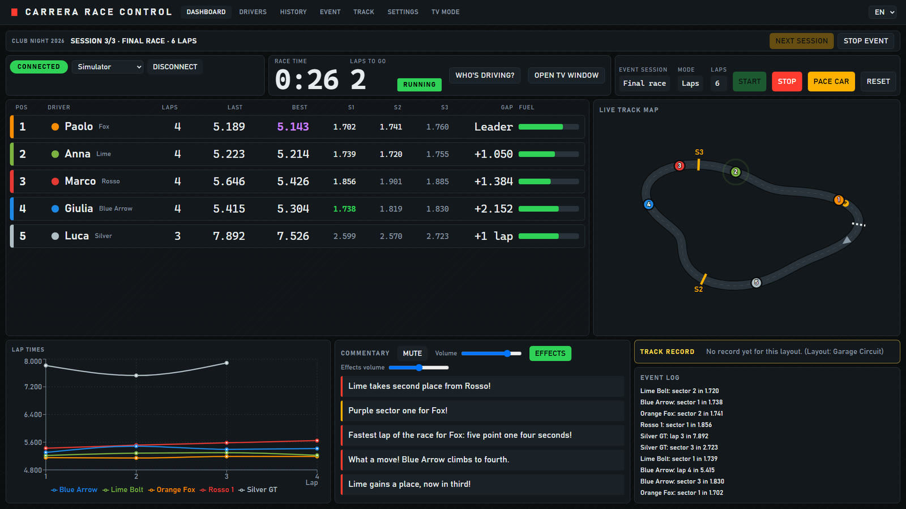
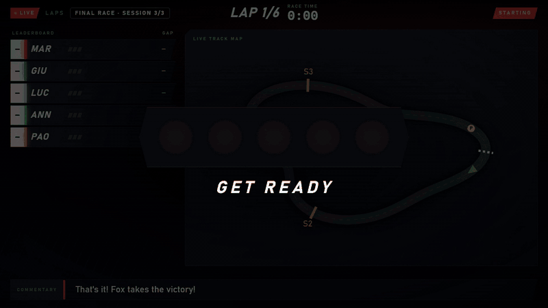
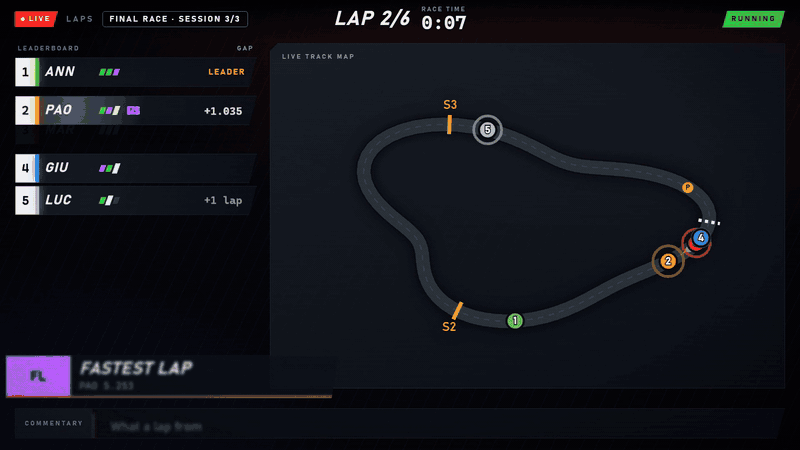
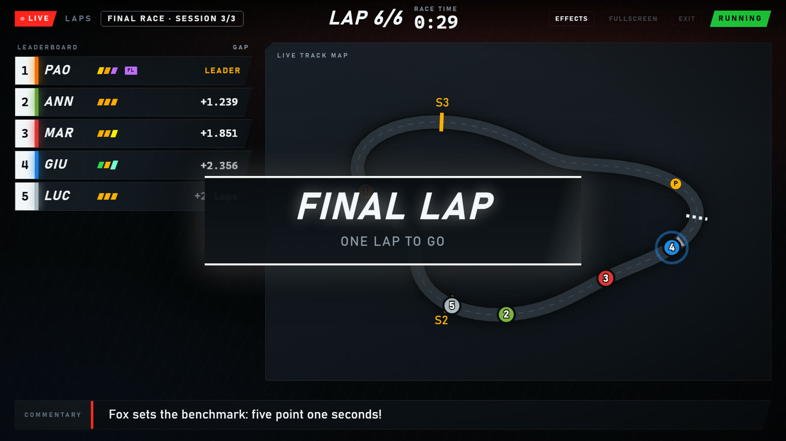
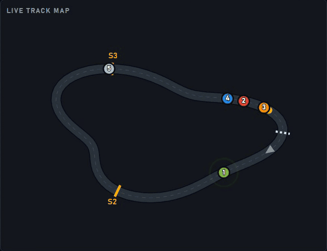
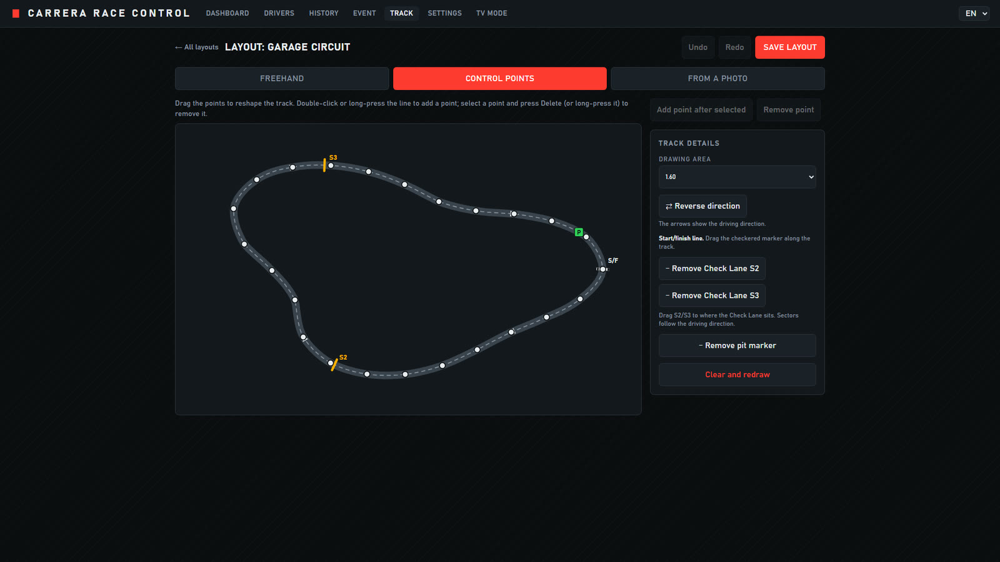
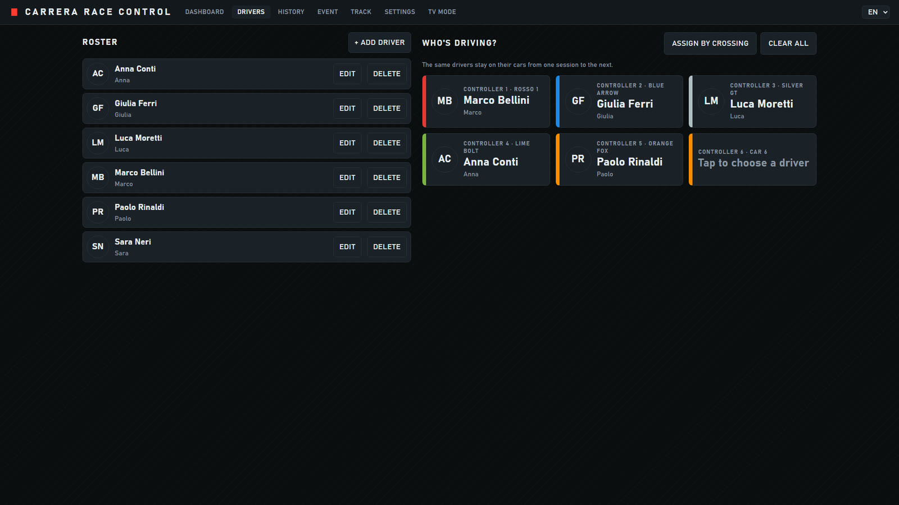
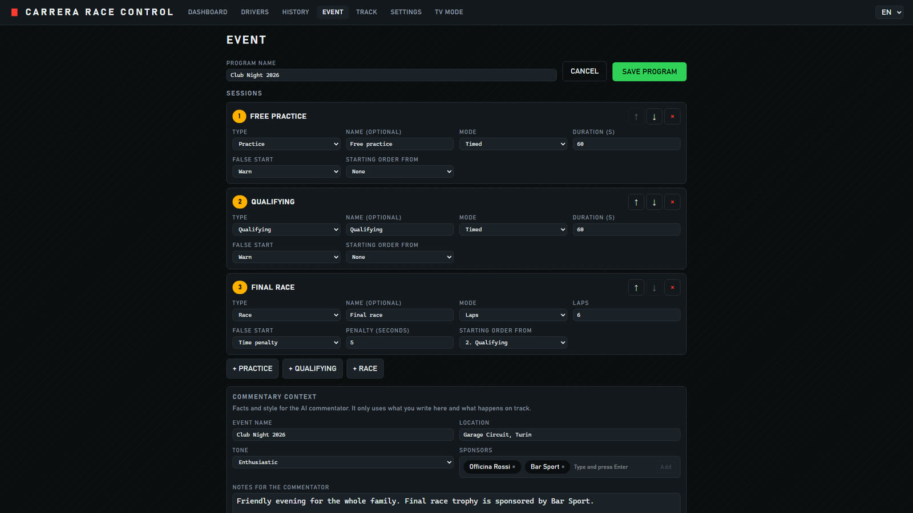
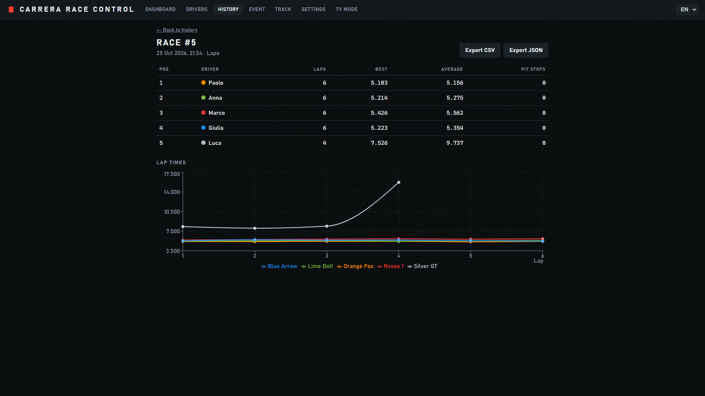
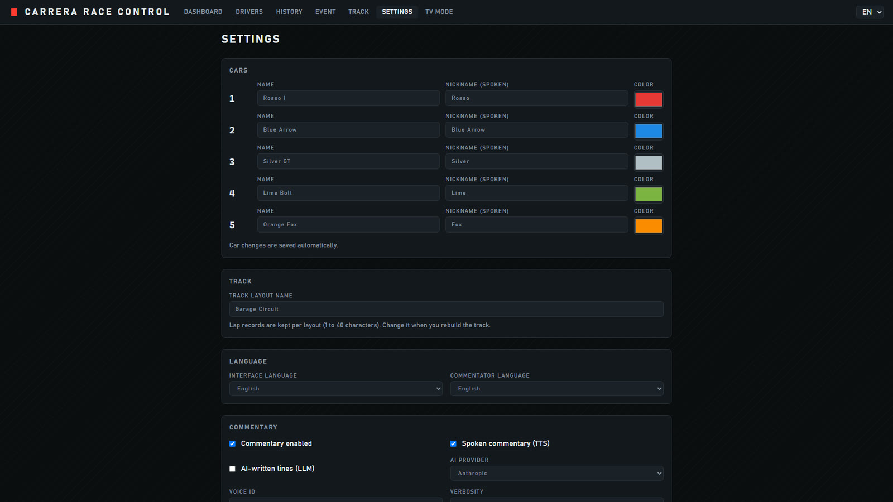

# Carrera Race Control

Local race control for a Carrera Digital 124/132 slot car track. It talks to the Control Unit (CU) over Bluetooth LE (or serial), turns the raw timing data into laps, positions and race events, shows them in a live web dashboard, and has an AI commentator that speaks the action through ElevenLabs text to speech.

Everything also works without a track thanks to a built-in simulator. The interface and the commentary are available in English and Italian.

This is an unofficial tool. See the [trademark notice](#trademarks).



## Features

- Live leaderboard: position, lap count, last and best lap (purple for the overall best), gap to leader, fuel bar, pit badge, animated position changes.
- Race modes: free practice, N laps, timed race. Start, stop, reset and pace car controls, start lights.
- Lap chart, event log, race history with CSV and JSON export.
- TV mode (`#/tv`): fullscreen leaderboard plus the latest commentary line.
- Commentator: priority director (never speaks over itself, drops stale lines, high priority lines interrupt), ElevenLabs streaming TTS with disk cache and character budgets, optional LLM written color lines with template fallback.
- Settings for car names, colors and spoken nicknames, commentary options, budgets.
- Robust connection handling: reconnect with backoff, clear error messages (for example "close the Carrera app"), graceful shutdown.
- Raw session recording and replay, so a real race can be reused in tests.
- UI and commentary in English and Italian.

## Screenshots

All images were captured from the built-in simulator with demo data (fictional drivers and cars).

**TV mode** (`#/tv`): start lights, then the live leaderboard tower, track map and race banners such as "Fastest lap" and "Final lap".







**Live track map**: cars move along the drawn layout, with the Check Lane sensors S2 and S3 marked.



**Track editor** (`#/track`): draw the layout, place the Check Lane sensors and the start/finish line, or start from a photo.



**Drivers and "Who's driving?"** (`#/drivers`): a reusable roster, and one tile per controller to assign the driver.



**Event program** (`#/event`): practice, qualifying and race sessions with false start rules, starting order and context for the commentator.



**Race history**: results, lap times and CSV or JSON export of every race.



**Settings**: car names, colors and spoken nicknames, language, commentary options.



## Hardware

- A Carrera Digital 124 or 132 Control Unit with the **Carrera AppConnect** Bluetooth LE module, or the Carrera PC unit used over a serial port.
- The CU accepts **only one BLE connection at a time**. Close the official Carrera app (on every phone and tablet nearby) before connecting from this app.
- A PC with Bluetooth LE (BLE mode) or a serial port (serial mode).

The Bluetooth and serial layers come from [carreralib](https://github.com/tkem/carreralib). No Control Unit is needed for development: use the simulator.

## Quick start

Requirements: Python 3.11+, [uv](https://docs.astral.sh/uv/), Node.js (pnpm is run through `npx`, no global install needed).

```bash
# 1. Backend dependencies
cd backend
uv sync

# 2. Frontend dependencies
cd ../frontend
npx -y pnpm@9 install

# 3. Configuration (optional for the simulator)
cd ..
cp .env.example .env     # then edit .env
```

### Development: two processes

```bash
# terminal 1: backend on http://127.0.0.1:8000
cd backend
uv run python -m app

# terminal 2: frontend on http://127.0.0.1:5173 (proxies /api and /ws to the backend)
cd frontend
npx -y pnpm@9 dev
```

Open http://127.0.0.1:5173.

### Production: one process

```bash
cd frontend
npx -y pnpm@9 build
cd ../backend
uv run python -m app     # serves the API and the built dashboard on http://127.0.0.1:8000
```

`uv run uvicorn app.main:app` works too (it serves `frontend/dist` when it exists).

## Desktop app (Windows)

`desktop/` is an Electron shell that runs the whole app as a normal Windows program: it starts the backend on a free `127.0.0.1` port, opens the dashboard in a window and shuts everything down when you quit. The packaged app contains the backend built with PyInstaller, so Python, Node and uv are not needed on the target PC.

Build requirements: Node.js 22, Python with uv (as in the Quick start), no global tools.

```bash
cd desktop
npm install
npm run dev        # builds the shell, starts the local backend (uv run python -m app), opens the window
npm run dist       # frontend build + PyInstaller backend + NSIS installer
```

`npm run dist` writes the installer to `desktop/release/Carrera-Race-Control-Setup-<version>-<arch>.exe` (`x64` or `arm64`, the host architecture). The installer (English or Italian, from the Windows language) lets you install for the current user only (no admin rights) or for all users, and choose the installation folder; it creates desktop and Start menu shortcuts. The PyInstaller step alone is `npm run build:backend` (output in `backend/build/pyi-dist/`, spec in `backend/packaging/`). The backend also accepts `--host` and `--port` (`python -m app --port 9000`). `npm run smoke` launches the app with Playwright and checks the backend, the TV window, the configuration window and that no backend process is left.

**TV window.** Menu Window, "Open TV window" (or Ctrl+Shift+T) opens `#/tv` fullscreen and frameless on another monitor: the default is the first non-primary display, "Open TV window on..." lists all displays and remembers the choice. Esc leaves fullscreen, Ctrl+Shift+W (or Ctrl+Shift+T again) closes it. Only one TV window exists, the mouse cursor hides after 3 s, and if the monitor is unplugged the window moves back to the primary display. The page can do the same through `window.carreraDesktop` (`openTvWindow(displayId?)`, `listDisplays()`, `closeTvWindow()`, `setKeys()`, `getKeysStatus()`); the types are in `desktop/types/carrera-desktop.d.ts`.

**Configuration.** There is no `.env` in the packaged app: File, "Configuration..." (also reachable from the page with `carreraDesktop.openConfig()`) edits every variable of `.env.example` in English or Italian, grouped as API keys, voice and models, track, simulator, commentary, network and advanced. Empty fields use the default shown in the field, with a "Reset to default" link; values are validated like the backend does (types, ranges, comma separated lists). Secrets (`*_API_KEY`) are encrypted with Electron `safeStorage` (Windows DPAPI, tied to your Windows user) in `keys.enc.json` and only shown as configured or not, with replace and remove; everything else is in `config.json`. All values reach the backend only through its process environment, never the dashboard or TV windows, and are never logged. Saving restarts the backend. `DATA_DIR` is managed by the app (read-only, with an "Open folder" button). The app's own address is always added to `ALLOWED_HOSTS` and `CORS_ORIGINS`. If secure storage is unavailable, secrets are not stored. File, "Import from .env file..." migrates an existing `.env` once (secrets are stored encrypted, the file is not kept). The field list is one table, `desktop/src/config-schema.ts`; `npm run check:env` (part of `npm run build`) fails when `.env.example` or `AppConfig` has a variable missing from it, so add one line there for every new variable.

**Where data lives.** `%APPDATA%\Carrera Race Control\`: `data\` (SQLite database and TTS cache, the `DATA_DIR` of the backend), `logs\backend.log`, `keys.enc.json`, `config.json`, `desktop-prefs.json` (chosen TV display). The File menu opens the data and logs folders. If the backend crashes it is restarted with a growing delay and the window shows a status page meanwhile. The installer is not code signed, so SmartScreen may warn on first run.

### CI builds

`.github/workflows/desktop.yml` builds the installer for **x64** (`windows-latest`) and **ARM64** (`windows-11-arm`) on every push to `main` that touches `desktop/`, `backend/` or `frontend/`, on pull requests, on `v*` tags, when a release is published and on manual runs. Backend and frontend tests run on the x64 job. Download the installers from the run's **Artifacts** (`Carrera-Race-Control-Setup-x64`, `-arm64`).

**Releases.** Push a tag (`git tag v0.2.0 && git push origin v0.2.0`) or publish a release in the GitHub UI or with `gh release create`: both installers are attached to that release (it is created if missing, existing assets are replaced, so running both triggers is safe). The installer version is the tag without the leading `v`.

**ARM64.** PyInstaller cannot cross-compile, so the ARM64 installer is built natively on an ARM64 runner with ARM64 Python and Electron. `windows-11-arm` is a GitHub-hosted runner for public and private repositories (private repositories use the plan's minutes). To use another runner, set the repository variable `ARM64_RUNNER`. `windows-curses` (only used by carreralib's terminal UI) has no ARM64 wheel, so it is skipped there; the app never uses it. Locally: `npm run dist:arm64` on an ARM64 PC, `npm run dist:x64` on x64.

The installers are not code signed, so SmartScreen may warn on first run.

## Simulator mode

With `TRACK_MODE=simulator` (the default) the backend connects to a simulated Control Unit at startup: up to 6 cars with different pace, occasional slow laps, double triggers, fuel and pit stops. In the UI pick the simulator connection type and press Connect if it is not already connected, then start a race.

- `SIM_CARS` sets the number of cars (1 to 6).
- `SIM_TIME_SCALE` speeds time up (for example `20` for a 3 lap race in a few seconds).
- `REPLAY_FILE` makes the simulator connection replay a recorded session instead (see below).

A console version that needs no browser:

```bash
cd backend
uv run python scripts/simulate.py --laps 3 --time-scale 20
```

## Finding and testing the real Control Unit

```bash
cd backend
uv run python -m app.track.scan                         # list BLE devices and serial ports
uv run python -m app.track.console --address AA:BB:CC:DD:EE:FF
uv run python -m app.track.console --address COM3 --mode serial
uv run python -m app.track.console --simulator          # same tool against the simulator
```

The console prints every timer and status message plus computed lap times. Add `--start` to press START after connecting.

In the web UI, choose "Bluetooth (BLE)" or "Serial", press Scan, select the device and Connect. BLE and serial connections are only made on request, never automatically at startup.

On macOS the BLE address is a CoreBluetooth UUID instead of a MAC address; use whatever the scan prints.

### Recording and replaying a session

```bash
cd backend
uv run python -m app.track.console --address AA:BB:CC:DD:EE:FF --record session.jsonl
uv run python -m app.track.console --replay session.jsonl --speed 5     # 0 = as fast as possible
```

Recordings are JSON lines, one raw message per line. Set `REPLAY_FILE=path/to/session.jsonl` to run the whole app on a recorded session in simulator mode. A small sample lives in `backend/tests/fixtures/session_small.jsonl`.

## Configuration

Set variables in the environment or in a `.env` file at the repo root or in `backend/` (see `.env.example`). Empty values count as unset. Keys are never logged and never returned by the API.

| Variable | Default | Meaning |
|---|---|---|
| `ELEVENLABS_API_KEY` | none | Enables spoken commentary. Without it the commentary is text only. |
| `ELEVENLABS_VOICE_ID` | none | Default voice (can be overridden in Settings). |
| `ELEVENLABS_MODEL_ID` | `eleven_flash_v2_5` | TTS model override. |
| `ANTHROPIC_API_KEY` | none | Enables LLM written color lines (turn them on in Settings). |
| `ANTHROPIC_MODEL` | `claude-haiku-5-5` | Model used for those lines. |
| `TRACK_MODE` | `simulator` | `simulator`, `ble` or `serial`. Only the simulator connects automatically. If unset, the mode last used in the UI is kept. |
| `TRACK_ADDRESS` | none | BLE address (or UUID on macOS) or serial port (`COM3`, `/dev/ttyUSB0`). |
| `COMMENTARY_LANG` | `it` | Commentary language for a fresh settings database (`it` or `en`). Afterwards change it in Settings. |
| `DATA_DIR` | `backend/data` | SQLite database and TTS audio cache. |
| `SIM_CARS` | `4` | Simulated cars (1 to 6). |
| `SIM_TIME_SCALE` | `1.0` | Simulator speed factor. |
| `REPLAY_FILE` | none | Replay this recorded session instead of the simulator. |
| `CORS_ORIGINS` | `http://localhost:5173,http://127.0.0.1:5173` | Comma-separated origins allowed by CORS and by the Origin checks (dev). |
| `ALLOWED_HOSTS` | `127.0.0.1,localhost` | Comma-separated `Host` names the server answers to (DNS rebinding guard). |

### Security note

The API has no authentication: it is meant to listen on `127.0.0.1` only (the default). Do not expose it on a network. To keep web pages you visit from driving it, the backend refuses state-changing requests (POST/PUT/DELETE) and WebSocket connections whose `Origin` is neither the app itself nor one of `CORS_ORIGINS`, refuses requests marked `Sec-Fetch-Site: cross-site`, and only answers to the `Host` names in `ALLOWED_HOSTS`. Tools without an `Origin` header (curl, scripts) are allowed.

## Commentary

- **Language**: English or Italian, chosen independently of the UI language in Settings. Lines are built from several variants per event and spoken in natural form (times and gaps are verbalised, not read as raw milliseconds).
- **Voice**: ElevenLabs streaming TTS, default model Flash v2.5 (`eleven_flash_v2_5`, lowest latency, multilingual). Static phrases are cached on disk under `DATA_DIR/tts_cache`.
- **Budgets**: a session and a monthly character budget (Settings). Over budget, or on any TTS error such as a missing key or rate limiting, the commentary silently falls back to text only.
- **LLM (optional)**: with `ANTHROPIC_API_KEY` and "AI-written lines" enabled, every line is written live by an Anthropic Haiku model from the race situation (one short sentence, only the given facts), with the templates as instant fallback on timeout, error or rate limit. Fresh installs with a key get it enabled; existing installs must tick "AI-written lines (LLM)" in Settings once.
- **Audio output**: "This browser" streams the audio to the page (click anywhere once to allow audio, browsers block autoplay). "Server speakers" plays on the machine running the backend through `ffplay`; install FFmpeg and make sure `ffplay` is on the `PATH`, otherwise the app logs it and uses the browser.
- Mute and volume are in the commentary panel.

## Interface language

Use the EN/IT switcher in the header. The choice is stored in the settings. The backend sends codes, not UI strings, and the frontend translates them (`frontend/src/i18n/`). Backend error `detail` messages are in English.

## Testing

```bash
# backend
cd backend
uv run pytest -q
uv run ruff check . && uv run ruff format --check .

# frontend
cd frontend
npx -y pnpm@9 lint
npx -y pnpm@9 test -- --run
npx -y pnpm@9 build

# end to end (headless Chromium, simulator at 20x, temporary data dir)
cd frontend
npx -y pnpm@9 exec playwright install chromium     # once
npx -y pnpm@9 test:e2e
```

The Playwright run starts the backend and the Vite dev server itself, runs a 3 lap simulated race in the browser, checks the leaderboard, lap chart, commentary, history and the Italian UI, and fails on any console error. It stores its data in a temporary directory, never in `backend/data`.

## Troubleshooting BLE

First checks for every OS: the Carrera phone app is closed everywhere, the CU is powered on and close to the PC, Bluetooth is turned on. `uv run python -m app.track.scan` must list the unit.

- **Windows**: turn Bluetooth on in Settings. Pairing is not required; if connecting fails, remove any existing pairing of the unit under Bluetooth devices and try again. bleak uses WinRT, so a recent Windows 10 or 11 is needed. Toggling Bluetooth off and on often clears a stuck adapter.
- **macOS**: the first run asks for Bluetooth permission for your terminal (System Settings, Privacy and Security, Bluetooth); allow it and restart the terminal. Devices appear as CoreBluetooth UUIDs instead of MAC addresses, use that UUID as the address.
- **Linux**: needs BlueZ running (`systemctl status bluetooth`). Check the adapter with `bluetoothctl` (`power on`, `scan on`). If the radio is blocked, `rfkill list` and `rfkill unblock bluetooth`. Your user may need to be in the `bluetooth` group, or permission to use D-Bus for BlueZ. For a serial unit, add your user to the `dialout` group.

Errors shown in the UI are explained by code: busy (another app holds the connection), not found, permission, Bluetooth off, timeout.

## Known limitations

- carreralib runs bleak in its own non-daemon thread. If the Bluetooth disconnect hangs (seen with WinRT on Windows), that thread can keep the Python process alive after the server stopped. `python -m app` waits up to 5 s for such threads and then forces the exit; with `uvicorn app.main:app` you may have to press Ctrl+C again or close the terminal.
- Overtakes are estimated from start/finish line crossings only and are marked approximate.

## Project layout

```
backend/
  app/
    main.py, __main__.py   FastAPI app, `python -m app`
    config.py              environment settings (.env)
    service.py             race controller: track, engine, store, commentary, reconnect
    api/                   REST routes and the WebSocket hub
    track/                 TrackInterface, carreralib adapter, simulator, scan, console, record/replay
    race/                  models, race engine, SQLite store, CSV/JSON export
    commentary/            events, templates (en/it), director, LLM writer, ElevenLabs TTS
  scripts/simulate.py      console simulator run
  tests/                   pytest, including hypothesis property tests and session replay
frontend/
  src/                     React + TypeScript + Vite + Tailwind + Zustand + Recharts
  e2e/                     Playwright smoke test
desktop/                   Electron shell (Windows app), TV window, configuration window
docs/PROTOCOL.md           REST and WebSocket contract
PLAN.md                    product plan
```

## Trademarks

Carrera and AppConnect are trademarks of Carrera Toys GmbH. This project is an unofficial, independent tool and is not affiliated with or endorsed by Carrera Toys GmbH.
